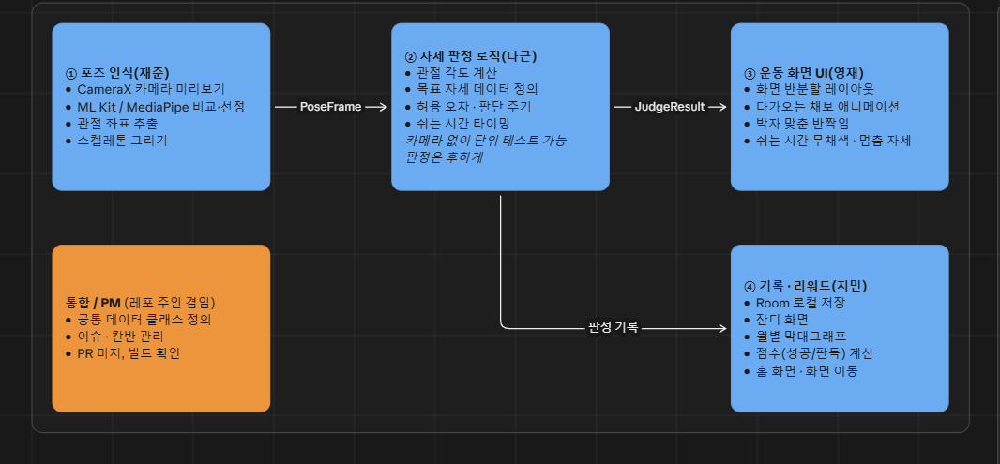

# 역할 분담



## 데이터 흐름

```
① 포즈 인식 ──PoseFrame──▶ ② 자세 판정 로직 ──JudgeResult──▶ ③ 운동 화면 UI
                                   │
                                   └──판정 기록──▶ ④ 기록 · 리워드
```

## 담당별 작업

### ① 포즈 인식 — 재준
- CameraX 카메라 미리보기
- ML Kit / MediaPipe 비교·선정
- 관절 좌표 추출
- 스켈레톤 그리기

### ② 자세 판정 로직 — 나근
- 관절 각도 계산
- 목표 자세 데이터 정의
- 허용 오차 · 판단 주기
- 쉬는 시간 타이밍
- 카메라 없이 단위 테스트 가능
- 판정은 후하게

### ③ 운동 화면 UI — 영재
- 화면 반반할 레이아웃
- 다가오는 채보 애니메이션
- 박자 맞춘 반짝임
- 쉬는 시간 무채색 · 멈춤 자세

### ④ 기록 · 리워드 — 지민
- Room 로컬 저장
- 잔디 화면
- 월별 막대그래프
- 점수(성공/판독) 계산
- 홈 화면 · 화면 이동

### 통합 / PM (레포 주인 겸임)
- 공통 데이터 클래스 정의 (`PoseFrame`, `JudgeResult` 등)
- 이슈 · 칸반 관리
- PR 머지, 빌드 확인
