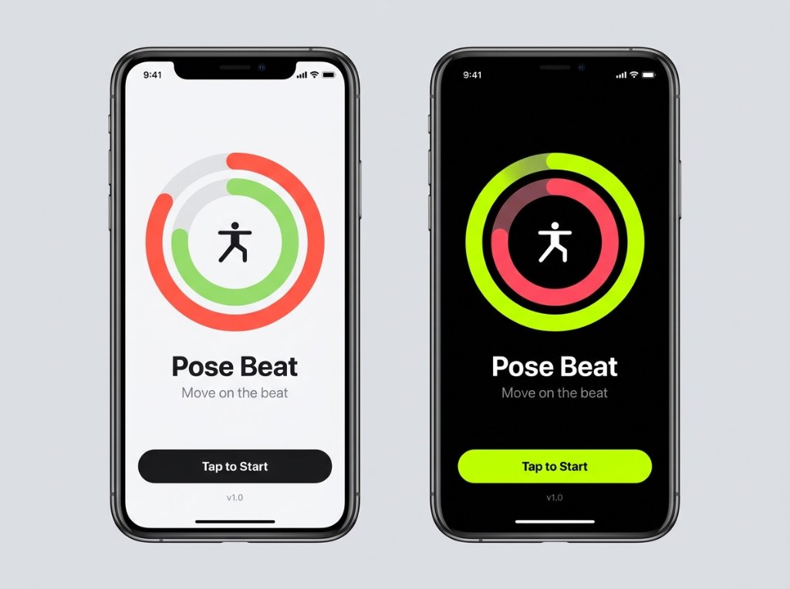
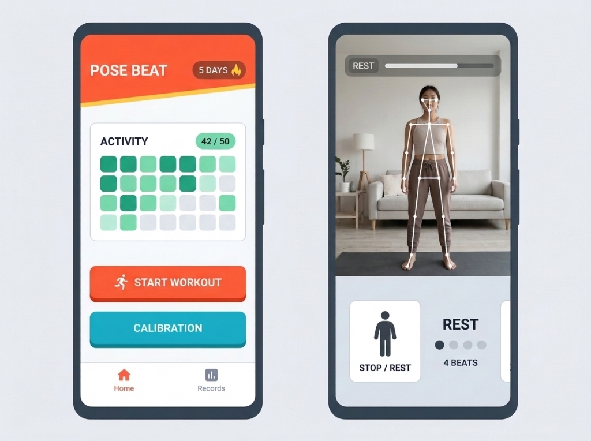
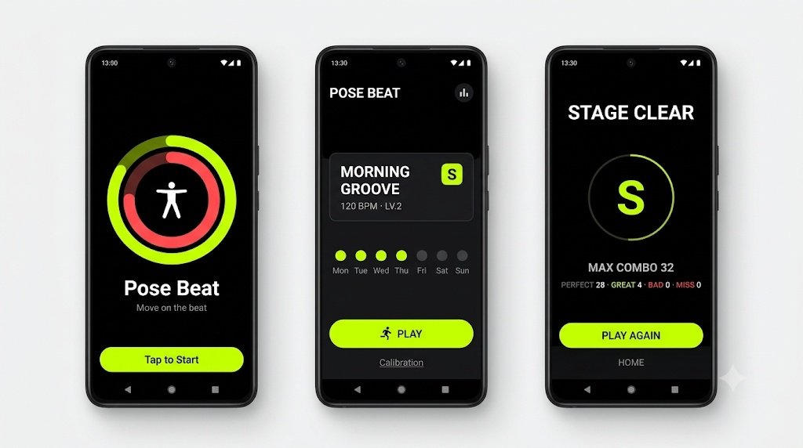
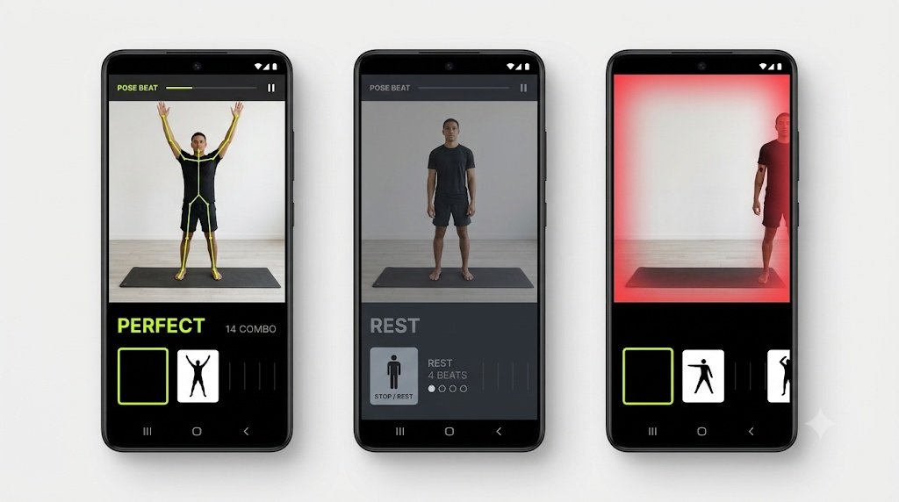

# 앱 UI 와이어프레임 (이슈 #8)

> ③(운동 화면 UI)과 ④(기록·리워드·내비게이션)가 같은 기준을 보고 구현하기 위한 화면 목록, 이동 흐름, 컬러 토큰, 레이아웃 규칙입니다.

---

## 1. 화면 목록 및 담당자

| 화면 | 경로(Route) | 담당 | 핵심 구성 요소 |
|---|---|---|---|
| **타이틀** | `title` | ④ (뼈대) / ③ (시안) | 동심원 액티비티 링 + 포즈 아이콘, `Pose Beat`, `Tap to Start` |
| **홈** | `home` | ④ (#15) | 상단 헤더(`POSE BEAT`, 연속 일수), 활동 잔디 카드(`ACTIVITY`, `성공/판독`), `START WORKOUT`, `CALIBRATION`, 하단 `Home` / `Records` 탭 |
| **권한 거절** | `permission` | ① (#11) | 카메라 권한 필요 안내, 설정 이동 / 다시 요청 버튼 |
| **보정** | `calibration` | ③ (#35) | 운동 화면과 동일한 위아래 반분할로 1단계(허용 오차)·2단계(지연 오프셋) 진행 후 저장 → 홈 |
| **준비** | `exercise` (`READY`) | ③ (#34) | 전신 인식 대기(`detection != DETECTED` 시 안내 문구) + 시작 카운트다운 |
| **운동** | `exercise` (`PLAYING`) | ③ (#27·#30·#32) + ① (#19) | **위아래 반분할**: 상단 3:4 카메라·스켈레톤(`PoseCameraView`) / 하단 수평 채보 레인 + 등급·콤보 |
| **휴식** | `exercise` (`REST`) | ③ (#33) | 상단 흐린 스켈레톤 / 하단 무채색 레인 + 신호등 멈춤 자세(`STOP / REST`) + 남은 박자 점 |
| **결과** | `result` | ④ (#22) | `STAGE CLEAR`, 랭크 링, `MAX COMBO`, 등급별 횟수(`PERFECT·GREAT·BAD·MISS`), `PLAY AGAIN`, `HOME` |
| **기록** | `record` | ④ (#23·#24) | 잔디 히트맵, 월별 막대그래프, 점수(`성공 / 판독`) 요약 |

---

## 2. 화면 이동 흐름

```text
[타이틀 (Tap to Start)]
        │
        ├─ (최초 실행 · 보정값 없음) ──▶ [보정 (#35)] ──▶ [홈]
        │
        ▼
     [홈 (#15)] ◀─────────────────────────────┐
      │   │  └─ (Records 탭) ──▶ [기록 (#23·#24)]
      │   └─ (CALIBRATION) ───▶ [보정 (#35)]
      │
      └─ (START WORKOUT) ──▶ (카메라 권한 없음) ──▶ [권한 거절 (#11)]
                                    │ (허용)
                                    ▼
                          [준비 (READY, #34)]
                                    │
                                    ▼
                [운동 (PLAYING)] ◀──┴──▶ [휴식 (REST, #33)]
                                    │ (FINISHED)
                                    ▼
                            [결과 (#22)] ──▶ (PLAY AGAIN → 준비 / HOME → 홈)
```

---

## 3. 핵심 레이아웃 및 표현 규칙

### 운동 화면 위아래 반분할 (세로 고정 권장, #8·#19)
- **상단 (~55%)**: ①의 `PoseCameraView` (`FIT_CENTER`로 3:4 카메라 비율 유지, 잘림 방지). 최상단에 얇은 진행 바 + 일시정지(`II`) 아이콘만 배치.
- **하단 (~45%)**: ③의 수평 채보 레인. 오른쪽 → 왼쪽 판정 칸으로 포즈 카드가 스크롤되며, **거울 기준**으로 카메라 속 사용자와 같은 쪽 팔이 올라가도록 표시(#30).
- **관절 이탈 경고 (`PoseFrame.edge`, #50)**: 상단 카메라 프레임 가장자리에 방향별(`left/right/top/bottom`) 빨간 그라데이션 비네트(`#FA2D48`)를 `0f..1f` 강도에 비례해 표시 (`SOFTWARE_LOSS` 시 미표시).

### 등급 표시 위치와 모양 (#3·#32)
- **위치**: 하단 채보 영역 상단 좌측(판정 칸 바로 위)에 등급 문구, 우측에 `COMBO` 표시.
- **모양**: 일치율(%) 숫자는 절대 표시하지 않으며, 굵은 산세리프 타이포그래피로 `PERFECT` / `GREAT` / `BAD` / `MISS`만 노출. 박자 전환 시 판정 칸 테두리가 짧게 반짝임.

### 홈 화면 기준 (라이트 메인 + 다크 컬러 매핑)
- **레이아웃 기준**: **라이트 시안의 홈 구성**(상단 헤더 + 연속 일수, `ACTIVITY` 잔디 카드·`성공/판독` 점수, `START WORKOUT`, `CALIBRATION`, 하단 `Home`/`Records` 탭)을 메인으로 사용.
- **다크 모드 적용**: 동일 홈 구조에 다크 컬러 토큰(`#000000` 배경, `#141416` 카드·`1dp #262629` 보더, `#B8FF00` 강조)을 그대로 매핑해 일관성 유지.

---

## 4. 컬러 토큰 (`ui/theme/` 기준, 라이트 & 다크 동시 대응)

플랫 디자인 원칙: `1dp` 보더 기반, 과한 드롭 섀도우·3D 광택·네온 글로우 금지.

| 역할 | 라이트 (`LightColorScheme`, 메인) | 다크 (`DarkColorScheme`) | 용도 |
|---|---|---|---|
| **Background** | `#F8F9FB` | `#000000` | 기본 화면 배경 |
| **Surface / Card** | `#FFFFFF` (보더 `#E5E8EE`) | `#141416` (보더 `#262629`) | 카드·시트 배경 |
| **Primary Accent** | `#FF453A` | `#B8FF00` | 메인 CTA, 판정 칸, 스켈레톤 |
| **PERFECT** | `#30D158` | `#B8FF00` | 최고 등급, 잔디 강조 |
| **GREAT / BAD** | `#0A84FF` / `#FF9F0A` | `#32D7FF` / `#FF9F0A` | 중간·낮음 등급 |
| **MISS / 이탈 경고** | `#FA2D48` | `#FA2D48` | 실패 등급, 가장자리 빨간 비네트 |
| **REST 레인** | `#ECEFF3` (텍스트 `#48484A`) | `#1C1C1E` (텍스트 `#8E8E93`) | 휴식 구간 무채색 전환 |

---

## 5. 참고 시안 이미지

### 라이트 메인 (타이틀 · 홈 · 휴식)



### 다크 모드 (타이틀 · 로비 · 결과 · 운동 · 휴식 · 관절 이탈 비네트)


